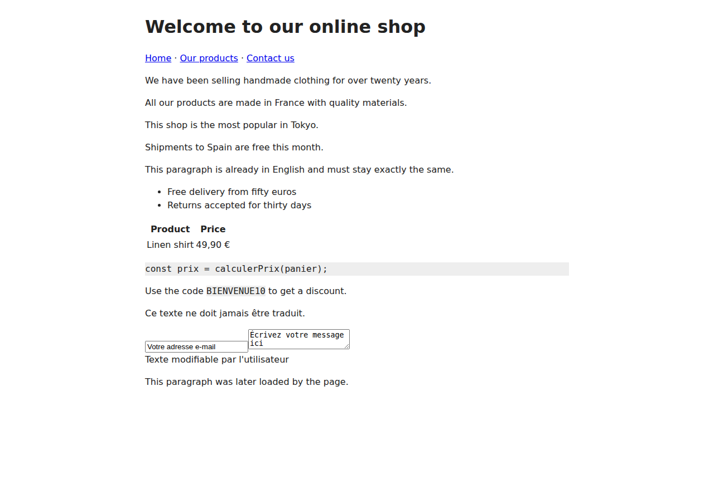
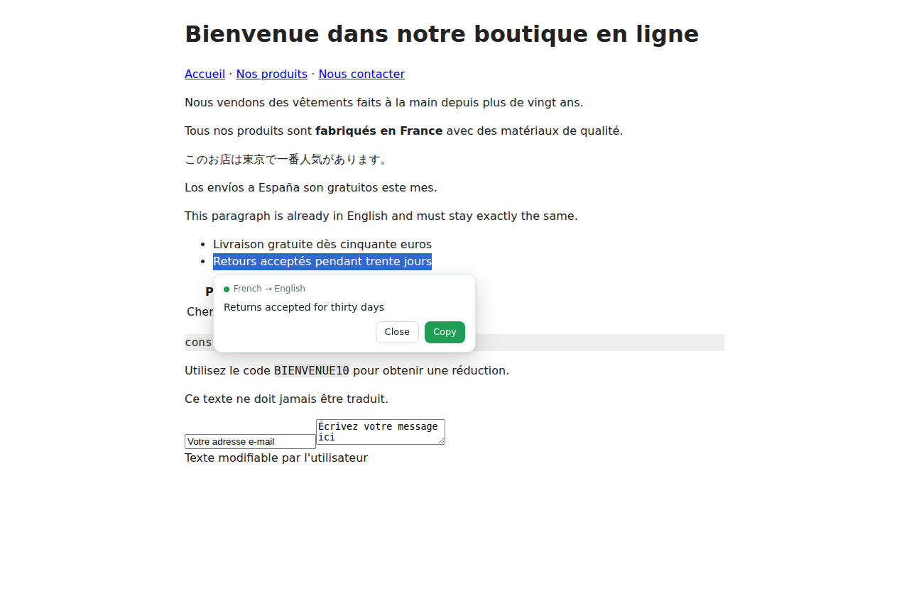
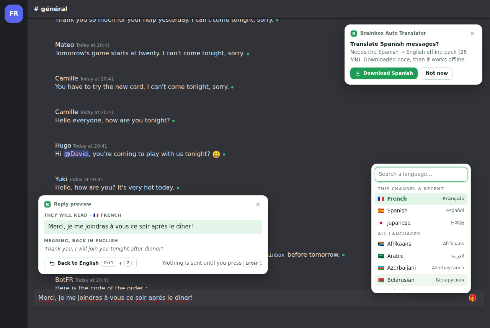
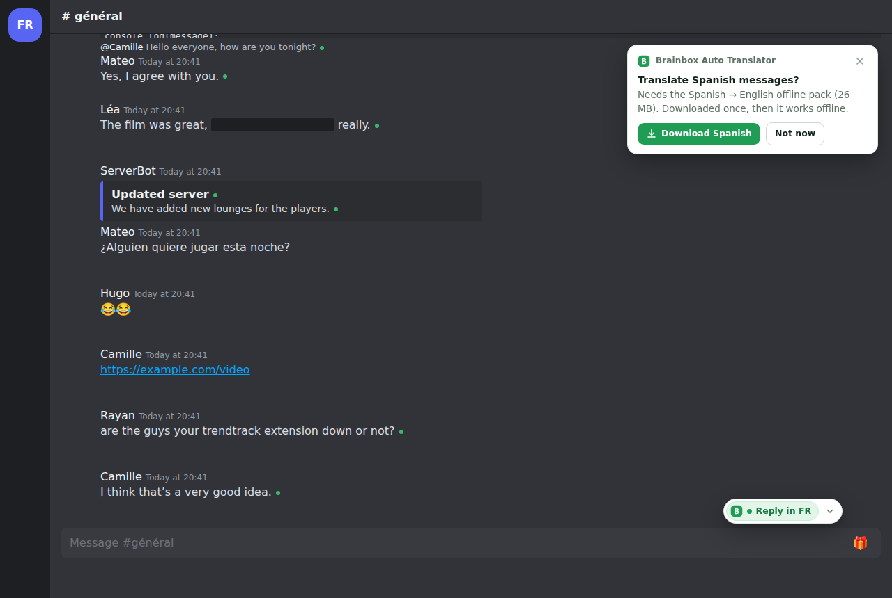
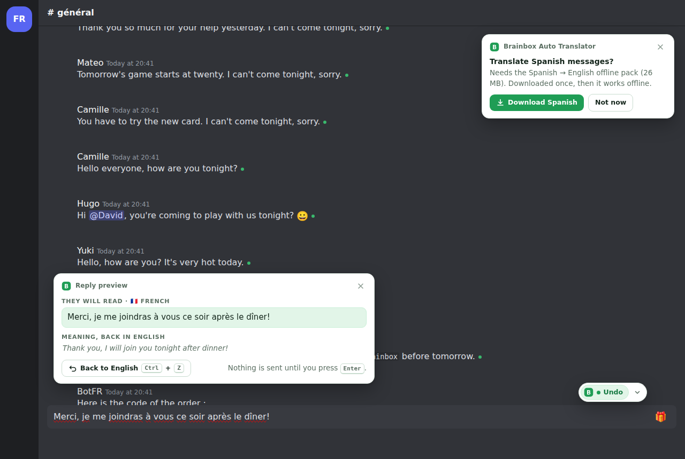
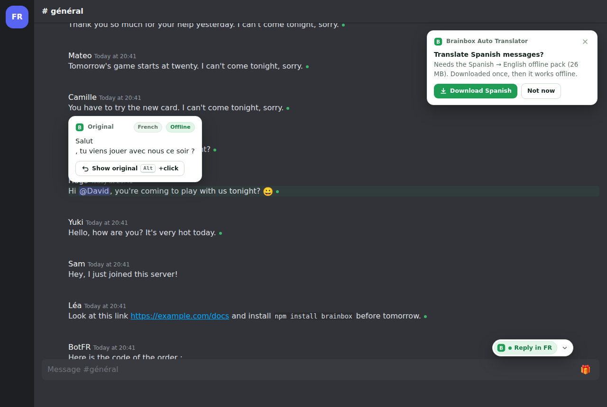
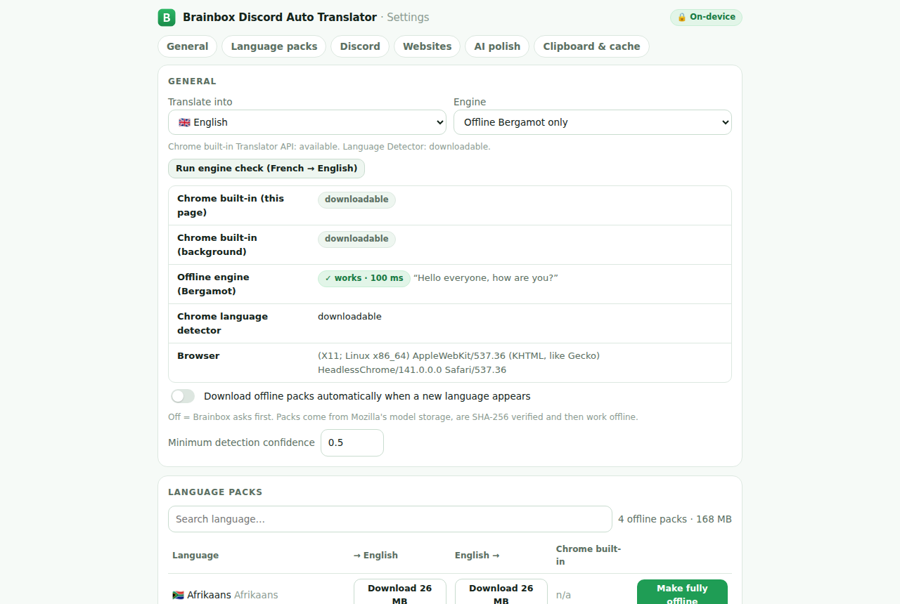
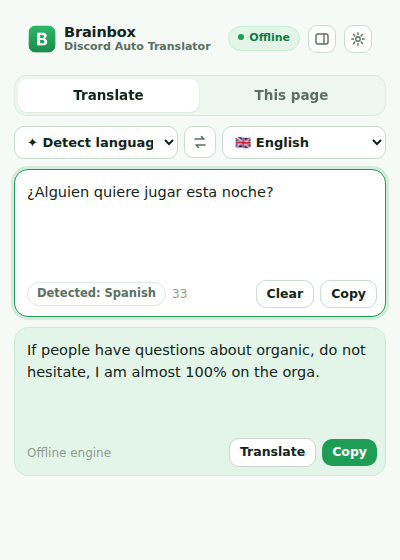
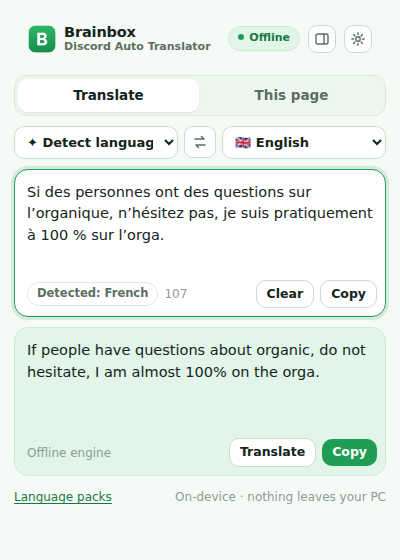
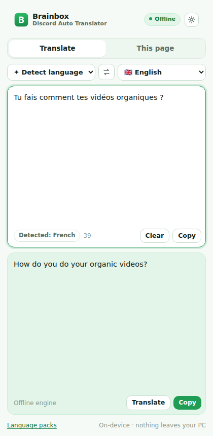

# Brainbox Translate — test report

Generated 2026-10-14T10:00:35.063Z for commit 8a197f31.

## Unit tests (Vitest)

**127 passed, 0 failed, 0 skipped** of 127.


## Engine tests (real Bergamot WASM + real models)

**7 passed, 0 failed, 0 skipped** of 7.


## End-to-end (Playwright, Chromium + unpacked extension)

| | Test | Project |
|---|---|---|
| ✅ | 500 messages: first visible translation, per-message latency, throughput, long tasks, memory | perf |

## Chrome built-in Translator API

```json
{
  "browserVersion": "141.0.7390.37",
  "mainWorld": {
    "Translator": "function",
    "LanguageDetector": "function"
  },
  "offscreen": {
    "chrome": "downloadable",
    "bergamot": "downloadable",
    "bergamotSize": 26234715,
    "detector": "downloadable"
  },
  "extensionPage": {
    "Translator": "function",
    "availability": "downloadable"
  },
  "testedAt": "2026-10-14T09:59:14.968Z"
}
```

## Performance (500 messages)

```json
{
  "messages": 500,
  "packsLoaded": [
    "fr-en",
    "ja-en",
    "es-en"
  ],
  "oneTimeModelLoadMs": 625,
  "timeToFirstTranslatedMessageMs": 197,
  "firstTranslatedAfterFirstRowMountMs": 103,
  "visibleMessages": 7,
  "newMessageLatencyMs": {
    "n": 10,
    "p50": 54,
    "p95": 68,
    "max": 68,
    "all": [
      53,
      53,
      68,
      53,
      54,
      54,
      55,
      54,
      54,
      53
    ]
  },
  "warmVisibleMessageLatencyMs": {
    "n": 7,
    "p50": 387,
    "p95": 437,
    "max": 437
  },
  "coldVisibleMessageLatencyMs": {
    "p50": 453,
    "p95": 502,
    "max": 502
  },
  "history": {
    "messagesTranslated": 435,
    "messagesPerSecond": 26.8,
    "engineTexts": 288,
    "seconds": 16.2,
    "engineTextsPerSecond": 17.7,
    "engineCalls": 149,
    "cacheHits": 0
  },
  "longTasks": {
    "count": 0,
    "totalMs": 0,
    "maxMs": 0
  },
  "idleMainThreadBusyMsPer3s": 7,
  "memory": {
    "pageJsHeapMB": 11,
    "extensionProcessRssMB_before": 1622,
    "extensionProcessRssMB_with3packs": 1632,
    "wasmHeapReservedMB": [
      "fr-en:523",
      "ja-en:853",
      "es-en:522"
    ],
    "allChromiumRssMB": 2649
  }
}
```

## Screenshots

### discord-after


### discord-before


### discord-hover-original


### discord-reply-preview


### options-discord


### options-packs


### page-after



### page-before


### popup-en-fr


### popup-fr-en


### selection-card



### v2-discord-lang-menu



### v2-discord-notice-pill



### v2-discord-reply



### v2-discord-tooltip



### v2-engine-check



### v2-popup-pack



### v2-popup



### v2-sidepanel


