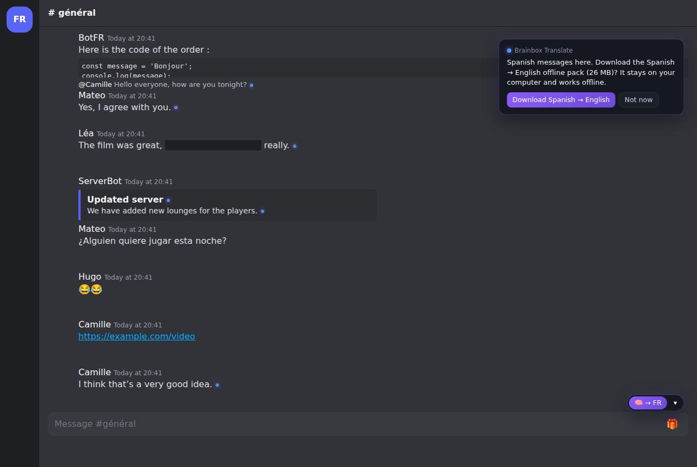
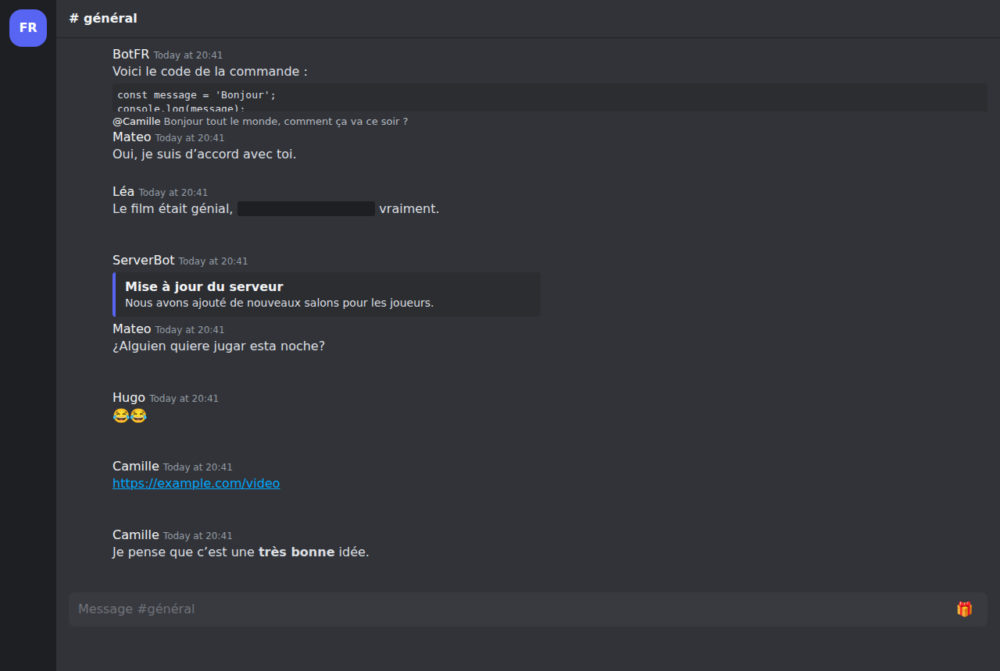
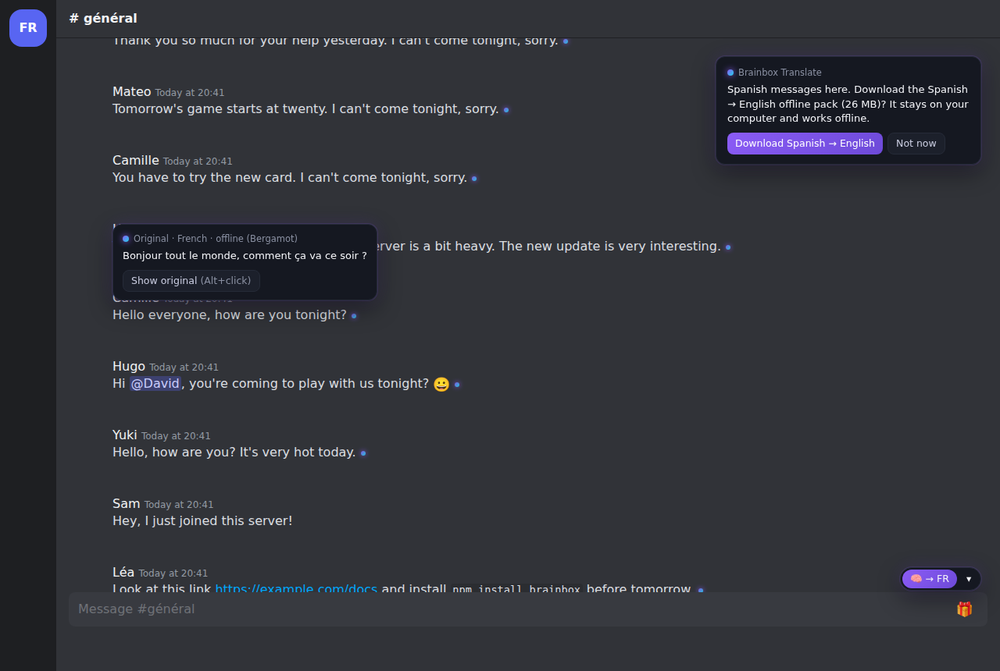
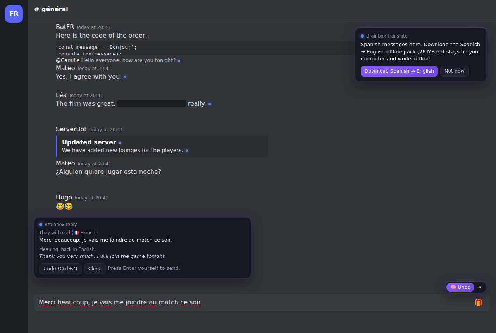
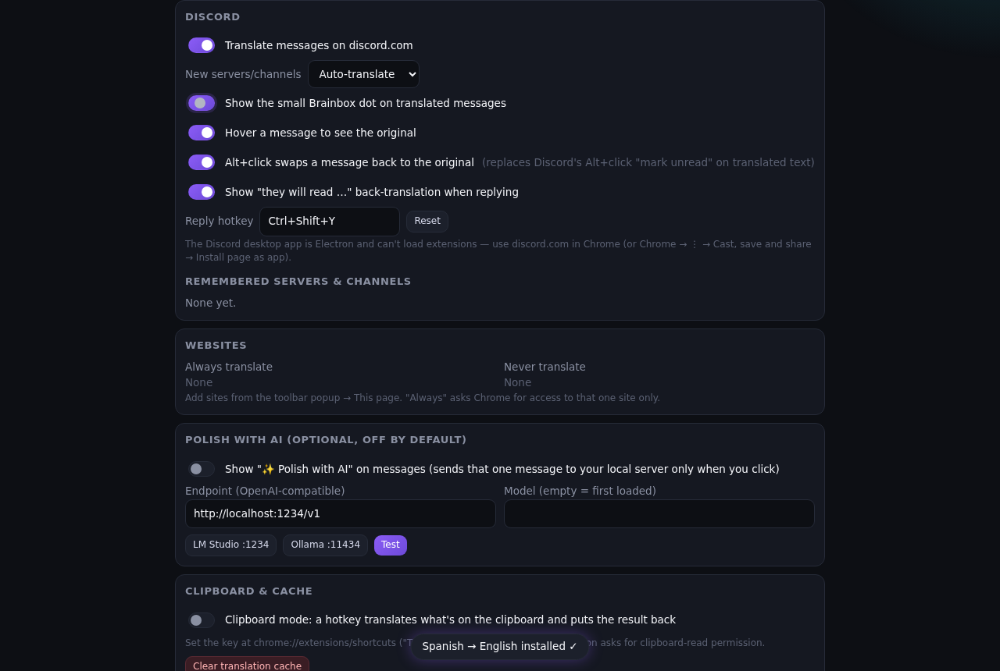
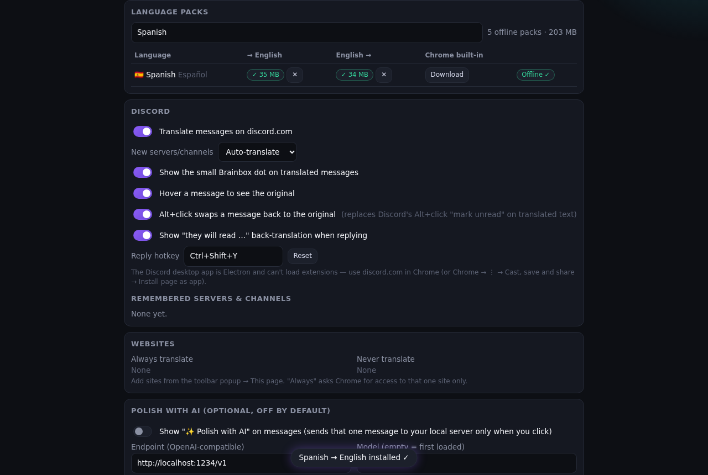
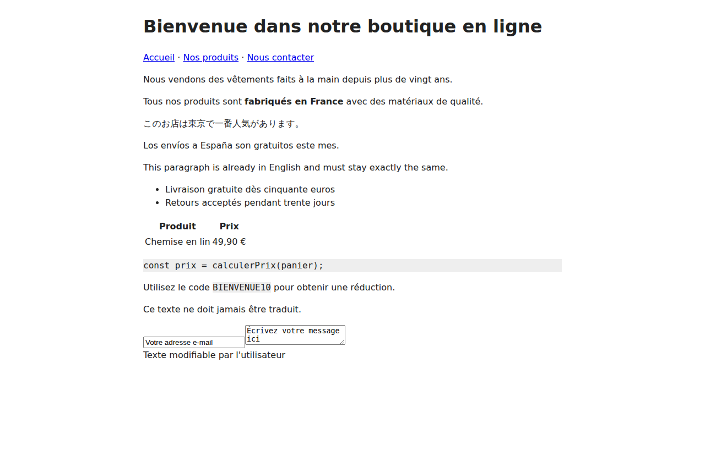
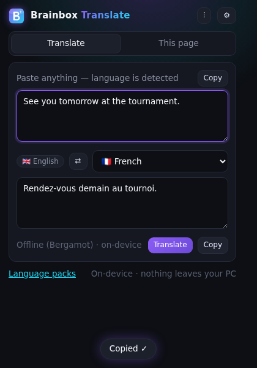
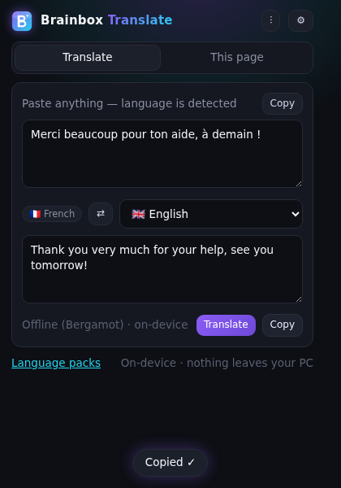

# Brainbox Translate — test report

Generated 2026-10-13T16:36:57.449Z for commit ff0ee128.

## Unit tests (Vitest)

**103 passed, 0 failed, 0 skipped** of 103.


## Engine tests (real Bergamot WASM + real models)

**7 passed, 0 failed, 0 skipped** of 7.


## End-to-end (Playwright, Chromium + unpacked extension)

| | Test | Project |
|---|---|---|
| ⏭ | Chrome built-in Translator API: availability in content script, offscreen document and extension page<br><sub>not-tested: Chrome built-in translation could not be run here: availability is "downloadable" (this Chromium build cannot download Google's on-device model). The wrapper logic is unit-tested with a mocked API. skip: Translator availability is "downloadable" — on-device model not obtainable in this browser</sub> | e2e |
| ✅ | before/after screenshots | e2e |
| ✅ | visible French and Japanese become English; mentions, emoji, links, code untouched | e2e |
| ✅ | scrolling away and back re-applies from cache with no new engine calls | e2e |
| ✅ | editing a message re-translates it | e2e |
| ✅ | hover shows the original; Alt+click swaps one message back and forth | e2e |
| ✅ | hotkey rewrites the English draft into the channel language; preview, undo, and Slate sends the translation | e2e |
| ✅ | mentions, :emoji:, links and `code` in a draft survive translation; the button works too | e2e |
| ✅ | language override from the dropdown (search by name) | e2e |
| ✅ | settings page: pack manager lists, downloads and removes packs; settings persist | e2e |
| ❌ | mixed-language page: translate, follow late content, then Show original restores it exactly | e2e |
| ⏭ | right-click "Translate selection to English" shows a card with Copy | e2e |
| ✅ | paste French → English → copy; then English → French with Ctrl+Enter; swap | e2e |
| ✅ | Japanese → English; a missing pack shows a download button that installs it | e2e |

## Chrome built-in Translator API

```json
{
  "browserVersion": "141.0.7390.37",
  "mainWorld": {
    "Translator": "function",
    "LanguageDetector": "function"
  },
  "offscreen": {
    "chrome": "downloadable",
    "bergamot": "downloadable",
    "bergamotSize": 26234715,
    "detector": "downloadable"
  },
  "extensionPage": {
    "Translator": "function",
    "availability": "downloadable"
  },
  "testedAt": "2026-10-13T16:35:51.501Z"
}
```

## Performance (500 messages)

_not run_

## Screenshots

### discord-after



### discord-before



### discord-hover-original



### discord-reply-preview



### options-discord



### options-packs



### page-before



### popup-en-fr



### popup-fr-en


